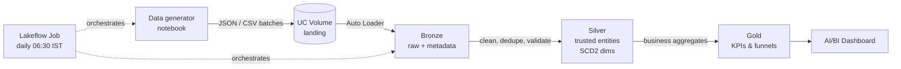

# Darunz E-commerce Lakehouse on Databricks

A production-style **medallion lakehouse** for an Indian e-commerce business, built on **Databricks Free Edition** with
**Lakeflow Declarative Pipelines**, **Auto Loader**, **Unity Catalog** and **Declarative Automation Bundles (DABs)**.

> Built in public by **Darunz** (Databricks Certified Data Engineer). Follow the weekly progress on LinkedIn.

---

## Architecture



| Layer | Tables | Status |
|---|---|---|
| Landing | `/Volumes/<catalog>/<schema>/landing/{orders,clickstream,customers,products}` | ✅ Week 1 |
| Bronze | `bronze_orders`, `bronze_clickstream`, `bronze_customers`, `bronze_products` | ✅ Week 1 |
| Silver | `silver_orders`, `silver_order_items`, `silver_clickstream`, `dim_customers` (SCD2), `dim_products` (SCD2), quarantine | ⏳ Week 2 |
| Gold | daily revenue by city/category, conversion funnel, customer LTV | ⏳ Week 2–3 |
| Governance & CI/CD | Unity Catalog grants, lineage, GitHub Actions deploy | ⏳ Week 3 |
| Serving | AI/BI dashboard + docs | ⏳ Week 4 |

## The data

The generator produces one batch per run, the way real exports arrive:

- **orders** (JSON lines): nested `items` array, UPI-heavy payment mix, INR prices, 12 Indian cities
- **clickstream** (JSON lines): sessions moving through `page_view → product_view → add_to_cart → checkout → purchase`
- **customers** (CSV): full load on batch 1, then new sign-ups + profile changes (`updated_at`) → CDC feed
- **products** (CSV): full catalog on batch 1, then price changes → SCD Type 2 material

It **deliberately injects dirty data**, so the Silver layer has real problems to solve:
duplicate orders (API retries), late-arriving orders (up to 3 days), null customer IDs, negative quantities,
unknown statuses and unparseable timestamps.

## Bronze design choices

- **Auto Loader** (`cloudFiles`) for exactly-once, incremental file ingestion; schema location and checkpoints
  are managed by the pipeline.
- Raw values kept as-is (timestamps stay strings) — parsing and validation happen in Silver, so Bronze can always be replayed.
- `_ingested_at` and `_source_file` (`_metadata.file_path`) on every row for lineage and debugging.
- `no_rescued_data` expectation (warn) surfaces schema drift in the pipeline event log without dropping data.

## Project structure

```
.
├── databricks.yml                                   # bundle: variables + dev/prod targets
├── resources/
│   ├── storage.yml                                  # UC schema + landing volume
│   ├── ecommerce_lakehouse.pipeline.yml             # Lakeflow declarative pipeline (serverless)
│   └── ecommerce_daily.job.yml                      # job: generate data -> refresh pipeline
└── src/
    ├── data_generator/generate_data.py              # raw data generator (notebook)
    └── pipelines/ecommerce_lakehouse/transformations/
        └── bronze/                                  # one dataset per file
```

## Run it yourself (Databricks Free Edition)

1. Sign up for [Databricks Free Edition](https://www.databricks.com/learn/free-edition).
2. Install the [Databricks CLI](https://docs.databricks.com/dev-tools/cli/install.html) and log in:
   ```bash
   databricks auth login --host https://<your-workspace>.cloud.databricks.com
   ```
3. Put your workspace URL in `databricks.yml` (both targets).
4. Validate, deploy and run:
   ```bash
   databricks bundle validate --strict
   databricks bundle deploy            # dev target: resources get a [dev <you>] prefix
   databricks bundle run ecommerce_daily
   ```
5. Run the job 2–3 more times to simulate new days of data, then explore the Bronze tables in Catalog Explorer.

## Roadmap

- [x] **Week 1** — Repo, bundle, landing volume, data generator, Bronze ingestion with Auto Loader
- [ ] **Week 2** — Silver: parsing, dedup, expectations + quarantine, SCD2 dimensions with Auto CDC
- [ ] **Week 3** — Gold KPIs, Unity Catalog governance and lineage, GitHub Actions CI/CD
- [ ] **Week 4** — AI/BI dashboard, docs, architecture diagram, launch post

---

Author: **Darun N (Darunz)** · [GitHub](https://github.com/darunnatarajan) · [LinkedIn](https://www.linkedin.com/in/darunn)
